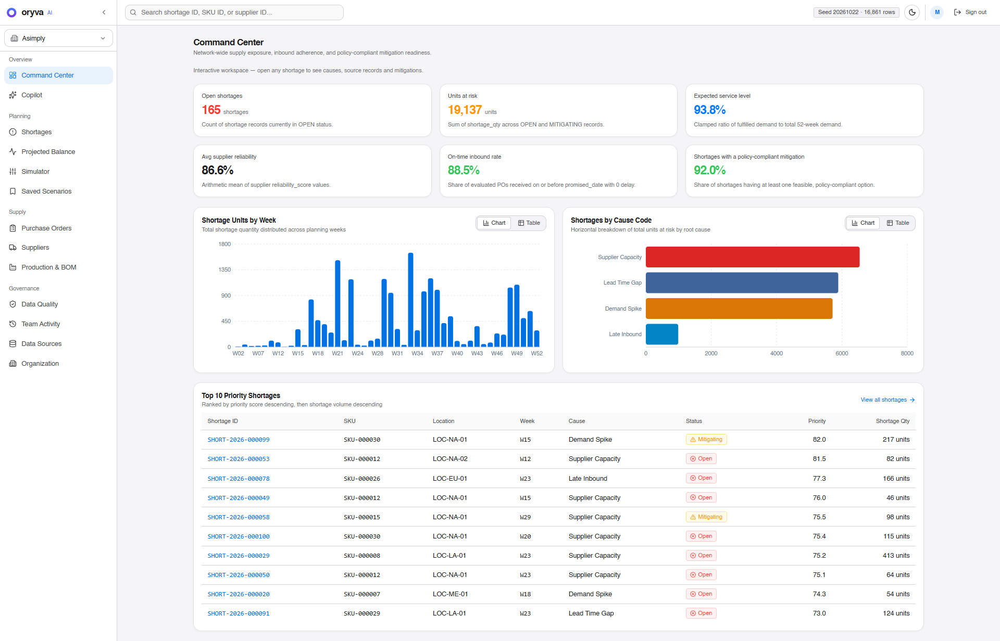
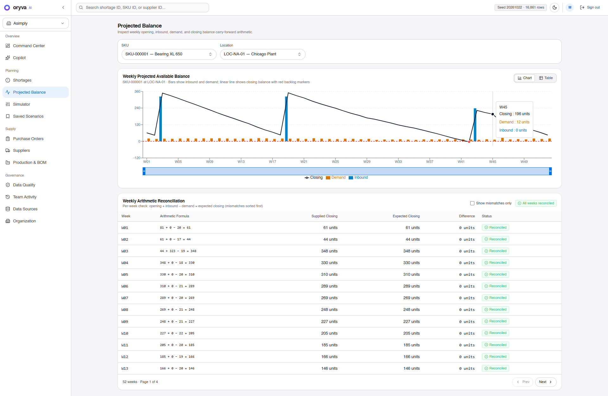
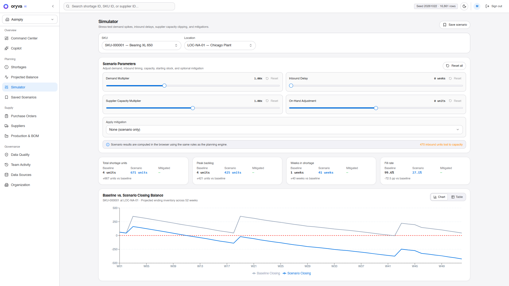
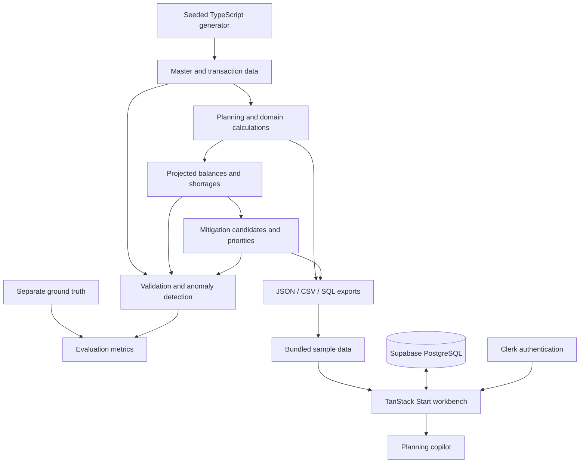

<div align="center">

# ORYVA AI — Supply Planning Workbench

**Demand, Inventory & Supply Planning · Shortage Intelligence · Decision Support**

A deterministic, explainable planning platform that turns supply chain data into actionable decisions.

    

[Preview](#product-preview) · [Overview](#overview) · [Features](#key-capabilities) · [Architecture](#architecture) · [Getting started](#getting-started) · [Validation](#validation--reproducibility)

</div>

---

## Product Preview

### Command Center
Network-wide risk indicators, weekly shortage trends, root-cause breakdown and prioritized exceptions.



<table>
<tr><td width="50%"><b>Projected Available Balance</b></td><td width="50%"><b>What-if Scenario Simulator</b></td></tr>
<tr><td><a href="docs/screenshots/project-balanced.png"></a></td><td><a href="docs/screenshots/simulator.png"></a></td></tr>
<tr><td>Weekly inventory projections and arithmetic reconciliation.</td><td>Demand, inbound delays, capacity and mitigation comparisons.</td></tr>
</table>

<details>
<summary><b>Supplier Capacity &amp; Risk — view screenshot</b></summary>


Weekly capacity, peak allocation, utilization, reliability, minimum order quantities and lead times.

</details>

*Screenshots show the sample workspace; full-scale dataset statistics are documented separately below.*

---

## Overview

Built for the **ORYVA AI Student Technical Assignment — Demand, Inventory & Supply Planning**, this workbench brings forecasting, inventory, supplier constraints, production planning and shortage management into a unified decision-support environment.

Instead of simply displaying supply chain data, the system is designed to help planners answer four questions:

- **What** will run short, and when?
- **Why** is the shortage expected?
- **Which** mitigation alternatives are available, and what are their cost and service trade-offs?
- **How** can the underlying evidence and planning results be audited and reproduced?

The planning logic is implemented in TypeScript; the AI assistant is an additional interface for interpreting planning context, not the source of the deterministic dataset.

## Key capabilities

| Module | Implementation focus |
| --- | --- |
| Demand and inventory planning | Weekly SKU-location forecasts, inventory and projected available balance |
| Shortage intelligence | Cause codes, source references and weighted priority scoring |
| Supplier and purchase orders | Capacity, lead times, inbound orders and lifecycle events |
| Production and BOM | Production plans, component relationships and substitutions |
| Mitigation recommendations | Expedite, alternative sourcing, transfers and substitution candidates; cost, recovery and policy indicators |
| Scenario analysis | Interactive exploration of planning alternatives |
| Data governance | Runtime schemas, validation checks, labelled anomalies and evaluation metrics |
| Organization workspaces | Membership, owner/member roles, data import and activity tracking |
| Planning copilot | Context-based root-cause summaries, action plans and executive insights |

## Architecture



Ground truth is reserved for evaluation rather than supplied to the planning validation suite as an input feature.

### Technology stack

| Layer | Technology |
| --- | --- |
| Application | React 19, TypeScript, TanStack Start, Vite, Nitro |
| UI | Tailwind CSS, Radix UI, Lucide, Recharts |
| Data access | TanStack Query, Supabase |
| Persistence | PostgreSQL |
| Authentication | Clerk |
| Generation | Bun, deterministic TypeScript generator |
| Validation and testing | Zod, Vitest, Testing Library, ESLint, Prettier |
| AI assistance | Context-based planning assistant with optional Gemini integration |

## Planning methodology

1. Generate master entities before dependent transactions and lifecycle records.
2. Build weekly demand and supply records for active SKU-location combinations.
3. Calculate projected inventory and derive shortage quantities and causes.
4. Rank shortages and generate mitigation candidates with policy and feasibility indicators.
5. Inject labelled negative scenarios, run validation and evaluate detections against separate ground truth.
6. Export data and compare two same-seed runs using SHA-256 checksums.

The full-scale manifest defines these shortage priority weights:

| Factor | Weight |
| --- | ---: |
| Severity | 35% |
| Urgency | 25% |
| Service impact | 25% |
| Supplier risk | 15% |

## Full-scale dataset

The included full-scale manifest reports the following counts for seed **20261022**. Demand is generated for active SKU-location combinations, rather than a dense Cartesian product of every SKU and location.

| Entity | Records |
| --- | ---: |
| SKUs | 3,000 |
| Locations | 50 |
| Suppliers | 500 |
| Planning horizon | 52 weeks |
| Forecast demand | 313,872 |
| Projected balance | 313,872 |
| Inventory | 6,036 |
| Supplier capacity | 6,000 |
| Lead times | 6,036 |
| Purchase orders | 13,634 |
| Purchase order events | 41,673 |
| Production plans | 3,241 |
| BOM records | 480 |
| SKU substitutions | 361 |
| Shortages | 3,206 |
| Shortage events | 3,485 |
| Mitigation options | 9,296 |
| Labelled anomalies | 48 |

Source: [Full-scale manifest](data/full/manifest.json).

### Entity conventions

The generator uses canonical identifiers such as `SKU-000001`, `DEM-<sku>-<location>-2026W01`, `PO-2026-000001`, `SHORT-2026-000001` and `MIT-<shortage-id>-01`.

See the [data dictionary](docs/DATA_DICTIONARY.md) and [application database schema](supabase/schema.sql) for entity definitions and relationships.

## Getting started

### Prerequisites

- Node.js 22.12+ (or a compatible newer LTS release)
- npm
- Bun for dataset generation
- Supabase and Clerk projects for authenticated database-backed workflows

### 1. Clone and install

```bash
git clone https://github.com/mohmmadmafaz08/Oryaai-supply-planners.git
cd Oryaai-supply-planners
npm install
npm install -g bun
```

### 2. Configure environment

Create a `.env` file in the repository root with your own project configuration:

```dotenv
VITE_SUPABASE_URL=https://YOUR_PROJECT.supabase.co
VITE_SUPABASE_PUBLISHABLE_KEY=YOUR_SUPABASE_PUBLISHABLE_KEY
VITE_CLERK_PUBLISHABLE_KEY=YOUR_CLERK_PUBLISHABLE_KEY
```

For database-backed workflows, review and apply `supabase/schema.sql` to your own Supabase project, configure Clerk authentication and its Supabase integration, and verify access policies before using shared data. Additional server-side configuration may be required depending on the deployment. Never expose service-role keys or private API keys in client-side variables or commit `.env`.

### 3. Generate sample data and launch

```bash
npm run generate
npm run dev
```

Open the local URL printed by Vite (typically `http://localhost:5173`). The starter generation command publishes bundled sample data to `public/data/`.

### 4. Generate full-scale data

```bash
npm run generate:full
```

Or explicitly specify the seed and output directory:

```bash
bun scripts/generate.ts --scale full --seed 20261022 --out data/full
```

Full generation exports to disk without replacing the bundled starter data. To publish the full dataset to the application, append `--publish`; this replaces `public/data/` and may increase browser payload sizes. The generator replaces its output directory on each run.

## Validation & reproducibility

The generator executes twice with the same seed and compares serialized dataset checksums. It also runs rule-based validation and scores anomaly detection against the separate ground-truth dataset.

### Required negative scenarios

| Scenario | Validation focus |
| --- | --- |
| Inbound inventory counted twice | Receipt duplication and balance reconciliation |
| Unapproved substitute SKU | Substitution policy |
| Supplier capacity exceeded | Capacity limits |
| Shortage calculated without lead time | Lead-time basis |
| Units-of-measure mismatch | SKU unit consistency |

### Recorded evaluation results

| Metric | Exported result |
| --- | ---: |
| Injected anomalies detected | 48 / 48 |
| Detection precision | 100% |
| Detection recall | 100% |
| Explained shortage share | 100% |
| Same-seed SHA-256 matches | 17 / 17 files |

These are results recorded by the included generator reports, not independently certified benchmarks. The anomaly detector and validation suite serve related but distinct purposes.

**Known validation caveat:** the full-scale validation summary reports a failed `Shortage Lead-Time Basis` check under `CLEAN_BASELINE` (10 shortages), while evaluation metrics report zero unexpected failures. The generator's expected-check classification includes the injected lead-time anomaly. This grouping should be corrected or independently reconciled before claiming a fully clean baseline. Deliberately injected failures are expected in the evaluation dataset.

### Evidence files

- [Validation summary](data/full/validation_summary.md)
- [Validation report](data/full/validation_report.json)
- [Evaluation metrics](data/full/evaluation_metrics.json)
- [Ground truth](data/full/ground_truth.json)
- [Reproducibility report](data/full/reproducibility.json)
- [Source manifest](docs/SOURCE_MANIFEST.md)

### Run quality checks

```bash
npm run lint
npx tsc --noEmit
npm run test
npm run build
```

Run these commands in your environment to verify the current checkout. A production build or test pass should not be inferred solely from the exported data reports.

## Repository structure

```text
.
├── src/
│   ├── app/                 # Application context and organization state
│   ├── components/          # Shared UI components
│   ├── data/                # Data contracts and access
│   ├── domain/              # Planning and validation logic
│   ├── features/            # Planning workspaces and dashboards
│   ├── generator/           # Seeded generator and tests
│   ├── integrations/        # Clerk and Supabase integrations
│   ├── lib/                 # Application and server helpers
│   └── routes/              # TanStack routes
├── scripts/generate.ts      # Dataset generation CLI
├── data/starter/            # Starter exports
├── data/full/               # Full-scale exports and evidence
├── public/data/             # Bundled application data
├── docs/
│   ├── screenshots/        # Product screenshots
│   ├── DATA_DICTIONARY.md
│   └── SOURCE_MANIFEST.md
└── supabase/schema.sql      # Application database schema
```

## Data provenance and limitations

The supplied datasets are synthetic and generated by the project. Public datasets are referenced for schema inspiration only; no external source rows are used, according to the manifest.

Large full-scale JSON, CSV and SQL exports are selectively excluded by `.gitignore`. Regenerate them using the documented command. The CLI emits SQL inserts targeting `oryva_seed`; the referenced `docs/schema.sql` staging schema is not present in the supplied archive. The application schema in `supabase/schema.sql` is a separate artifact; verify compatibility or provide the staging DDL before attempting to import `seed.sql`.

Mitigation candidates and scenario results are decision-support outputs, not guarantees of globally optimal supply allocation. AI-generated recommendations should be reviewed against the underlying planning evidence.

## Assignment alignment

The project addresses the assignment through related planning entities, seeded starter/full datasets, deterministic IDs, projected balance and shortage calculations, mitigation candidates, event history, separate anomaly labels, validation reports and reproducibility evidence. The known limitations above are retained to make the submission transparent and auditable.

## Author

**Mahmad Mafaz Ameenbeg**  
B.E. Computer Science & Engineering (Data Science)  
New Horizon College of Engineering, Bengaluru

Developed for the ORYVA AI technical evaluation.

---

<div align="center">

**From supply chain data to explainable planning decisions.**

</div>
